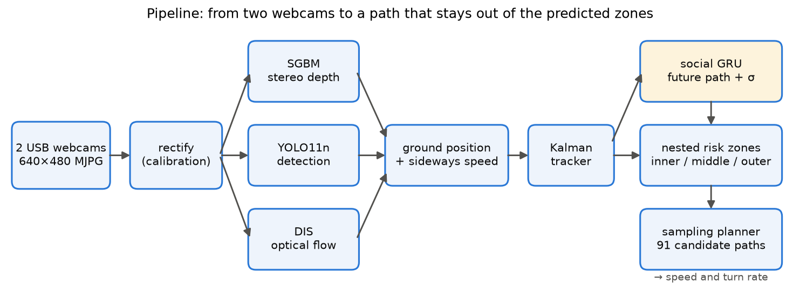
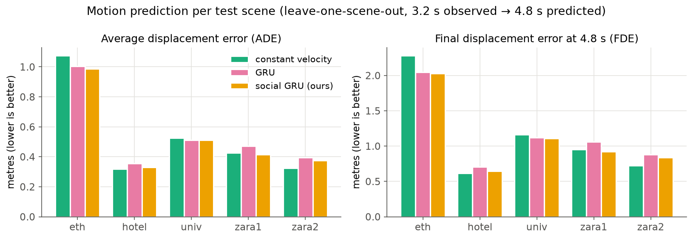
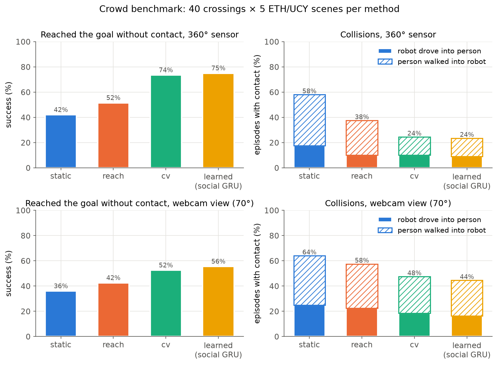
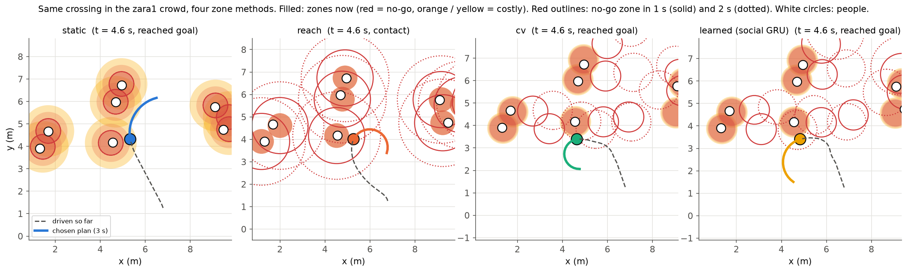
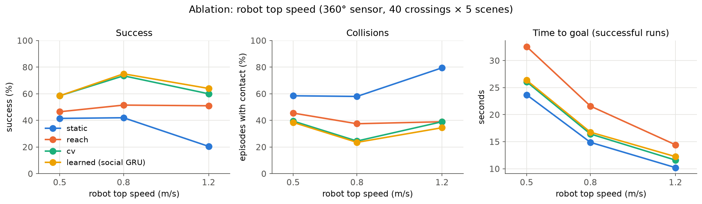
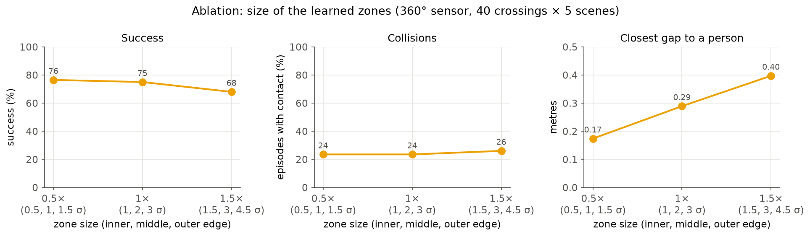
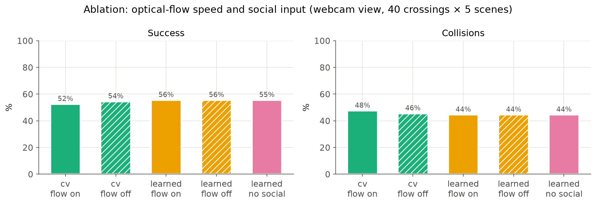
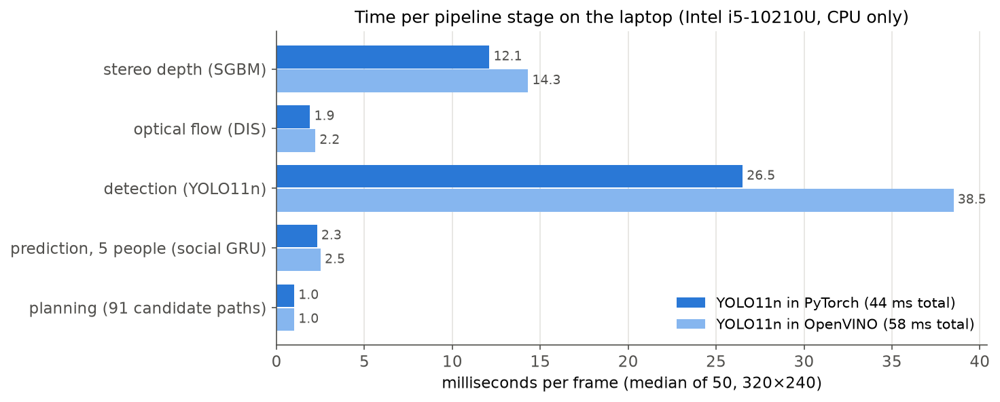
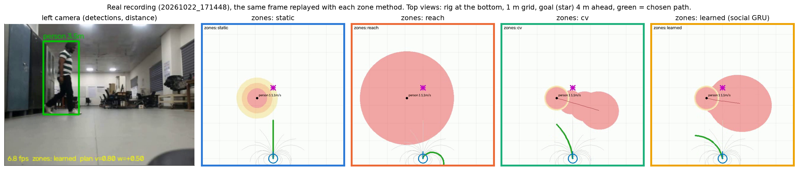

# Navigating among moving people with stereo webcams, optical flow and learned motion prediction

*Semester project report, 22 October 2026. All numbers are measured; the files they come from
are named in each section.*

## Abstract

A mobile robot that shares space with people must avoid not only where people are, but where
they are about to be. We build a complete, CPU-only pipeline from two USB webcams to a planned
path: stereo depth (SGBM) and dense optical flow (DIS) give each detected object (YOLO11n) a
position on the floor and a sideways speed; a ground-plane Kalman tracker fuses them; a small
social GRU, trained on the ETH/UCY pedestrian datasets, predicts every person's next 4.8 s
together with its own uncertainty; the prediction becomes three nested risk zones per person
(no-go, middle, outer) for every future time step; and a sampling planner picks the fastest
path that stays out of the no-go zones *at the time the robot would be there*. We compare four
ways of building the zones: where the object is now (static), where it could be given its
class's maximum speed (reach), a constant-velocity prediction (cv), and the learned prediction.
On the standard leave-one-scene-out protocol the social GRU predicts better than constant
velocity (ADE 0.52 vs 0.53 m, FDE 1.11 vs 1.15 m, NLL 1.12 vs 1.39). In a simulator where a
robot crosses the real recorded crowds 200 times per method, prediction-based zones reach the
goal without contact far more often than static or reach zones (75% learned, 74% cv, 52% reach,
42% static with a 360° sensor). With the webcams' 70° field of view all methods lose 6–22
points of success, which identifies the narrow view, not the predictor, as the main limit of
this hardware. On the real webcam rig (stereo RMS 0.37 px, depth within 7 cm up to 5 m after a
one-parameter disparity correction) the pipeline detects, tracks and predicts walking people at
10–11 fps, and the four zone methods behave on real recordings as they do in simulation. The
processing alone runs at 23 fps on the laptop CPU.

## 1 Introduction

Robots in corridors, campuses and shops move among people who do not stop for them. A costmap
that marks only where a person *is* makes the robot drive into the space the person is about to
step into; a costmap that marks everywhere a person *could* be makes the robot freeze. The idea
behind this project is to give every detected object a set of **nested zones** that depend on
what the object is and how it moves: an inner zone the robot must never enter, and middle and
outer zones that only cost something, all growing with the time horizon. The simplest version
uses only the object's class: a person walks at about 1.4 m/s and can run at 2.5 m/s, so after
*t* seconds they are inside a circle of radius 2.5·*t* (the *reach* zones). The better version
asks *where will this person most likely be, and how sure are we?* and answers it with a
learned motion predictor whose uncertainty sets the size of the zones.

Contributions of this project:

1. A complete, CPU-only stereo-webcam pipeline (calibration, rectification, SGBM depth, DIS
   optical flow, YOLO11n detection, ground-plane tracking with optical-flow speed fusion)
   written for a laptop and designed to fit a Raspberry Pi 4.
2. A small social GRU predictor (33k parameters, numpy inference) that predicts a correction to
   constant velocity plus an anisotropic uncertainty, trained with a Gaussian likelihood.
3. Four interchangeable zone constructions (static, class reach sets, constant velocity, learned)
   behind one interface, and a time-indexed sampling planner that uses them.
4. A reproducible benchmark that drives a simulated robot with a realistic camera model through
   the real ETH/UCY crowds, with collision attribution and ablations of field of view, optical
   flow, social input, robot speed and zone size.

## 2 Related work

**Pedestrian datasets.** The ETH (Pellegrini et al., 2009) and UCY (Lerner et al., 2007)
recordings, five scenes of people walking in public spaces annotated at 2.5 Hz, are the standard
benchmark for trajectory prediction, evaluated leave-one-scene-out with 8 observed and 12
predicted steps.

**Trajectory prediction.** Social LSTM (Alahi et al., 2016) introduced recurrent prediction
with pooling over neighbours; Social GAN (Gupta et al., 2018) added multimodal sampling;
Trajectron++ (Salzmann et al., 2020) uses graph-structured recurrent models with dynamics
integration and probabilistic outputs. Schöller et al. (2020) showed that a constant-velocity
model is a surprisingly strong baseline on ETH/UCY, which is why we report it alongside our
model and build the network as a correction to it.

**Planning among moving obstacles.** The Dynamic Window Approach (Fox et al., 1997) samples
velocity commands within the robot's acceleration limits and scores the resulting arcs; our
planner follows the same idea but scores each arc against time-indexed predicted zones.

**Perception.** Semi-global matching (Hirschmüller, 2008) is the classical dense stereo
method, available in OpenCV as SGBM. DIS optical flow (Kroeger et al., 2016) computes dense flow
at hundreds of frames per second on a CPU. YOLO11 (Ultralytics, 2024) provides real-time object
detection; its nano model runs on CPUs and embedded boards.

## 3 System

**Hardware.** Two Lenovo FHD USB webcams fixed side by side form the stereo pair, read at
640×480 MJPG (the most two webcams can share on one USB controller). Processing runs at half
resolution (320×240). The development computer is a Dell Vostro 3590 laptop (Intel i5-10210U,
4 cores / 8 threads, 23 GB RAM, integrated graphics only, Ubuntu 24.04). Both webcams deliver
frame pairs together at about 12 fps in indoor light (exposure-limited); with the whole pipeline
and recording running, the live loop ran at 10.4–10.8 fps.

**Calibration.** A ChArUco board (5×7 squares of 25 mm, 5×5 ArUco markers) is photographed
20–30 times in different positions; a pair is only saved when the board has been still for 10
frames, because the two webcams are not hardware-synchronised. Each camera is calibrated alone
(the third radial distortion term fixed at zero), then the pair is calibrated jointly
(`stereoCalibrateExtended`), dropping pairs whose reprojection error exceeds 1 px and
recalibrating. A sanity check rejects calibrations with impossible focal length or baseline.

*Result (22 Oct).* 25 pairs were captured; one was dropped for moving (1.6 px error). Single-camera
RMS 0.526 px (left) and 0.432 px (right), stereo RMS **0.373 px** over 24 pairs, rectified focal
length 525.6 px at 640×480, baseline **110.9 mm** against about 108 mm measured with a ruler between
the lens centres. The board size matters: with a wrongly assumed 25 mm square the same photos gave
a 92.4 mm baseline (exactly 25/30 of the true value), which the ruler check caught.

**Depth.** Rectified grey images go through SGBM (64 disparities, 7×7 blocks, 3-way mode). No
hole-filling filter is applied: filled-in depth invents obstacles. A detection's distance is the
median depth inside the central half of its box, which leaves out the background around a
person; without a calibration the distance falls back to the box height and a 1.7 m person.

*Depth against a tape measure* (`11_depth_check.py`, `results/depth_check.md`). A printed board
and box were placed 1–5 m from the lenses; the reading is the median depth in a 13×13 px square:

| true distance | raw stereo | raw error | with disparity offset | error |
|---|---|---|---|---|
| 1.0 m | 0.940 m | −6.0 cm (−6.0%) | 0.992 m | −0.8 cm |
| 2.0 m | 1.807 m | −19.3 cm (−9.7%) | 2.009 m | +0.9 cm |
| 3.0 m | 2.619 m | −38.1 cm (−12.7%) | 3.065 m | +6.5 cm |
| 4.0 m | 3.237 m | −76.3 cm (−19.1%) | 3.948 m | −5.2 cm |
| 5.0 m | 3.951 m | −104.9 cm (−21.0%) | 5.063 m | +6.3 cm |

Raw depth always read short, increasingly with distance. Converted to disparity, every reading
was too large by nearly the same amount (1.41–1.86 px at 320×240): a constant disparity offset,
which a small rotation left between the rectified cameras produces (1.62 px is about 0.35° of yaw;
board views at 0.4–2 m cannot pin this angle down). The code was checked first: the rectified
principal points are identical and the baseline agrees with the ruler. Subtracting the mean
offset, 1.62 px (`config.DISPARITY_OFFSET_PX`), from every disparity brings all five readings
within 7 cm. Note that this offset was **fitted on the same five points**, so the corrected column
shows that one constant explains the error, not an independent test; `11_depth_check.py` prints
the best offset for every new set of readings.

**Optical flow.** DIS flow (fast preset) between consecutive left images gives each object's
sideways image motion. The median flow outside all boxes, caused by the camera itself turning,
is subtracted. With the stereo distance *z* and focal length *f*, a sideways image motion of
*du* pixels per frame is a sideways speed of *−du·z/(f·dt)* m/s. Stereo depth is noisy from frame
to frame (a few centimetres at 1 m, 25 cm at 5 m), so speed from differentiated positions is
jumpy, while flow measures the sideways component precisely.

**Detection.** YOLO11n (COCO classes) at 320 px input, confidence 0.4. Objects on desks (tv,
laptop, phone, book…) are ignored. OpenCV's HOG person detector is a fallback when Ultralytics is
not installed.

**Tracking.** Each object is a constant-velocity Kalman filter in the ground plane (x forward,
y left, metres). A detection updates the position with a distance-dependent noise
(0.02 + 0.01·*z²* m), and the optical-flow speed updates the velocity along the direction
perpendicular to the viewing ray. Detections are matched to tracks greedily by distance within
a 1 m gate (plus half the track's position uncertainty); a track counts after 3 detections and is
dropped after 1 s unseen. Each track keeps a short history, from which the predictor's input
(8 positions 0.4 s apart) is interpolated.

## 4 Risk zones

Every object gets three nested zones for each planning time step *t* = 0, 0.2, …, 3.0 s: inner
(cost 1.0, never entered), middle (0.5) and outer (0.15). Each zone is an ellipse aligned with the
object's heading; all are inflated by the object's body radius plus the robot's radius (0.25 m),
so the robot can be treated as a point. The four methods differ only in where the ellipses are
and how they grow.

**static.** Circles around the current position with radii *R*, *R*+0.3, *R*+0.6 m, constant over
time (*R* = body + robot radius). This is what a plain costmap does.

**reach.** Circles around the current position that grow with the object's class speeds: radius
*R* + *v*·*t* with *v* = ½ typical, typical, maximum speed for inner, middle and outer. The class
table (`config.CLASS_MOTION`):

| class | typical speed (m/s) | maximum speed (m/s) | body radius (m) |
|---|---|---|---|
| person | 1.4 | 2.5 | 0.30 |
| bicycle | 4.0 | 8.0 | 0.60 |
| motorcycle | 6.0 | 15.0 | 0.80 |
| car | 5.0 | 15.0 | 1.20 |
| bus, truck | 5.0 | 15.0 | 1.50 |
| dog | 1.5 | 6.0 | 0.35 |
| cat | 1.0 | 4.0 | 0.25 |
| sports ball | 3.0 | 10.0 | 0.15 |
| any other class | 0 (static obstacle) | 0 | 0.30 |

**cv.** The object keeps its last velocity. The uncertainty of this guess is *measured* on the
training data: for each future step, the RMS error along and across the heading. The zones are
ellipses around the predicted position with semi-axes *R* + *k*·σ, *k* = 1, 2, 3.

**learned.** The social GRU (below) predicts both the mean future path and its own standard
deviations along and across the heading; the zones are the same 1/2/3-σ ellipses around it.

### 4.1 The social GRU predictor

*Input.* The last 8 positions (3.2 s) are turned into 7 displacements, rotated so that the last
step points along +x (the *canonical frame*: the network never has to learn that walking north
and walking east are the same thing) and divided by 0.5 m. The 6 nearest other people within
5 m are described by their relative position (÷ 2 m) and velocity, in the same rotated frame,
plus a presence flag.

*Network.* A GRU (64 hidden units) reads the displacements. A two-layer MLP (5→32→32, ReLU)
embeds each neighbour, and the embeddings are max-pooled over present neighbours. The GRU state
and the pooled neighbour feature go through an MLP (96→128→48) that outputs, for each of the 12
future steps, a correction (*dx*, *dy*) to constant velocity and two positive increments of
standard deviation (softplus). Positions are the cumulative sum of (last step + correction), so
an untrained network already predicts constant velocity; standard deviations are cumulative too,
so uncertainty can only grow with the horizon. 32,912 parameters (27,568 without the social part).

*Training.* Gaussian negative log-likelihood of the true future offsets, with separate σ along
and across the heading; Adam (learning rate 2·10⁻³, cosine schedule), 20 epochs, batch 256,
gradient clipping at 1; random left/right mirroring and 3 cm input noise (tracker noise); the
epoch with the best validation NLL is kept. Inference is a plain-numpy copy of the network, so
the robot does not need PyTorch.

### 4.2 From prediction to zones

Predictions come at 0.4 s steps; centres and σ are interpolated to the planner's 0.2 s steps,
starting from the current position with σ = 5 cm at *t* = 0. The ellipse for zone level *k*
has semi-axes *R* + *k*·σ_along and *R* + *k*·σ_across, rotated by the object's heading.

## 5 Planner

The robot is a unicycle (top speed 0.8 m/s, turn rate 1.5 rad/s, acceleration 1 m/s²). Every
0.2 s the planner rolls out 91 constant commands (7 speeds × 13 turn rates) for 3 s, with the
speed ramping at the acceleration limit. Each rollout point is checked against the zones *at
its own time*. A candidate's score is its closest approach to the goal, plus 2 × the
time-integrated zone cost, plus a small turning penalty; candidates that enter a no-go zone get
+100, plus up to +100 the earlier they enter, so that if every candidate is blocked the robot
picks the one that stays clear longest (usually braking or turning away). Points after the goal
is reached cost nothing. Only the first 0.2 s of the best candidate is executed.

## 6 Experiments

**Prediction.** ETH/UCY in the Trajectron++ split (raw files of the Social-GAN preprocessing),
8 observed and 12 predicted steps at 0.4 s, sliding windows over every person without gaps.
Leave one scene out: train on four scenes (validation on their validation files), test on the
fifth. Training/test windows per held-out scene: eth 30,307 / 364, hotel 29,676 / 1,197,
univ 9,874 / 24,334, zara1 28,577 / 2,356, zara2 26,076 / 5,910. Metrics: ADE (mean distance
over the 12 steps), FDE (distance at 4.8 s), NLL of the 2-D Gaussian per step, and the fraction
of final positions inside the 2-σ ellipse (95% for a calibrated Gaussian would be ideal only
if errors were Gaussian; heavier tails give less).

**Navigation simulator.** The test file of each scene is replayed; pedestrians follow their
recorded paths and do not react to the robot (the usual setup on these datasets, which tests the
robot's own avoidance). Each episode is a 10 m crossing through a busy part of the scene,
starting at a random time with at least two people present. The robot's sensor sees people
within 8 m and inside its field of view (360° or the webcams' 70°), misses each detection with
probability 0.1, and adds position noise that grows with distance squared like stereo
(0.02 + 0.01·*d²* m along the ray, 3 cm across). With optical flow on, it also measures each
person's sideways speed with 0.08 m/s noise. Everything after the sensor is the real pipeline:
tracker → zones → planner. 40 crossings per scene, 200 per method, with identical crossings,
noise and missed detections for every method (fixed seeds). In each scene the predictor is the
model trained without that scene.

**Metrics.** *Success*: reaching within 0.3 m of the goal without any contact (contact = centre
distance below 0.2 m person + 0.25 m robot). *Collisions*, split into **robot at fault** (at
first contact the robot was moving faster than 0.1 m/s and the person was inside its forward
90° cone) and **person walked into robot** (everything else: the robot was stopped or slow, or
was hit from the side or behind, which a non-reactive pedestrian cannot avoid). *Time to goal*
for runs that reached it, *closest gap* (mean over episodes of the smallest robot–person
clearance; negative means overlap), and *time standing still*.

## 7 Results

All numbers below come from the files in `results/`; the figures are made from them by
`10_make_figures.py`.

### 7.1 Motion prediction

Leave-one-scene-out, 3.2 s observed → 4.8 s predicted (`results/predictor_metrics.md`):

| test scene | constant velocity ADE / FDE | GRU ADE / FDE | social GRU ADE / FDE |
|---|---|---|---|
| eth | 1.08 / 2.28 | 1.00 / 2.05 | **0.99 / 2.03** |
| hotel | **0.32 / 0.61** | 0.35 / 0.71 | 0.33 / 0.65 |
| univ | 0.52 / 1.17 | 0.51 / 1.12 | **0.51 / 1.11** |
| zara1 | 0.43 / 0.95 | 0.47 / 1.06 | **0.41 / 0.92** |
| zara2 | **0.32 / 0.72** | 0.40 / 0.88 | 0.37 / 0.84 |
| **average** | 0.53 / 1.15 | 0.55 / 1.16 | **0.52 / 1.11** |

| average over scenes | NLL ↓ | true final position inside the 2-σ zone |
|---|---|---|
| constant velocity (measured σ) | 1.39 | 84% |
| GRU | 1.31 | 85% |
| social GRU (ours) | **1.12** | 85% |

The social GRU has the lowest average ADE, FDE and NLL. Constant velocity remains very strong,
and is still best on the two scenes with the most regular walking (hotel, zara2). The GRU
without neighbours is worse than constant velocity on average; the neighbour input is what lifts
the network above it, most clearly in zara1 (ADE 0.41 m with neighbours, 0.47 m without).

### 7.2 Navigation through recorded crowds

40 crossings × 5 scenes per method, identical crossings and sensor noise for every method
(`results/nav_metrics_fov360.md`, `results/nav_metrics_webcam.md`):

| zones | success | collisions (robot at fault + person walked into robot) | time to goal | closest gap |
|---|---|---|---|---|
| **360° sensor** | | | | |
| static | 42% | 58% (18 + 40) | 14.9 s | −0.01 m |
| reach | 52% | 38% (10 + 28) | 21.6 s | 0.39 m |
| cv | 74% | 24% (10 + 14) | 16.4 s | 0.26 m |
| learned | **75%** | **24% (9 + 14)** | 16.8 s | 0.29 m |
| **webcam view, 70°** | | | | |
| static | 36% | 64% (25 + 39) | 14.5 s | −0.03 m |
| reach | 42% | 57% (23 + 35) | 17.2 s | 0.06 m |
| cv | 52% | 48% (18 + 29) | 14.4 s | 0.08 m |
| learned | **56%** | **44% (16 + 28)** | 14.4 s | 0.10 m |

(Fault columns are rounded separately, so they can differ from the total by 1.)

Success per scene (360° / webcam):

| scene | static | reach | cv | learned |
|---|---|---|---|---|
| eth | 38 / 38% | 40 / 38% | 55 / 40% | 52 / 40% |
| hotel | 50 / 55% | 55 / 62% | 85 / 68% | 85 / 62% |
| univ | 38 / 15% | 40 / 20% | 65 / 20% | 72 / 38% |
| zara1 | 40 / 32% | 62 / 48% | 82 / 62% | 82 / 68% |
| zara2 | 45 / 40% | 60 / 45% | 80 / 72% | 82 / 70% |

Findings:

- **Prediction-based zones work best.** cv and learned reach the goal without contact in about
  three of four crossings with a full view, against 42% for static and 52% for reach zones.
- **Reach zones are safe but slow.** They keep the largest gap (0.39 m) but take 45% longer than
  static zones (21.6 vs 14.9 s), because a circle that grows at 2.5 m/s soon covers most of the
  scene, and the robot has to wait or detour.
- **Learned vs cv** are close with a full view (75 vs 74%). With the webcam view the learned
  zones are 4 points better (56 vs 52%), most of it in univ, the densest scene (38 vs 20%).
- **Most remaining contacts are people walking into the robot.** With learned zones and a 360°
  sensor, 14 of the 24 contact percentage points are a (non-reactive) person reaching a stopped
  or slow robot, or reaching it from the side or behind; 9 points are the robot driving into
  someone.

### 7.3 Ablations

**Robot top speed** (360°, `results/nav_metrics_vmax*_fov360.md`):

| top speed | static | reach | cv | learned |
|---|---|---|---|---|
| 0.5 m/s | 42% | 46% | 58% | 58% |
| 0.8 m/s (default) | 42% | 52% | 74% | **75%** |
| 1.2 m/s | 20% | 51% | 60% | **64%** |

0.8 m/s is the best of the three speeds for every prediction-based method. A slower robot spends
longer in the crowd and is walked into more often (learned at 0.5 m/s: 11% robot at fault, 28%
person walked into robot); a faster one has less time to react to what it sees (static zones
collapse to 20%). The learned zones degrade least at 1.2 m/s.

**Zone size** (learned, 360°, `results/nav_metrics_sigma*_fov360.md`):

| zone edges (inner, middle, outer) | success | collisions | closest gap | time to goal |
|---|---|---|---|---|
| 0.5, 1, 1.5 σ | 76% | 24% | 0.17 m | 15.2 s |
| 1, 2, 3 σ (default) | 75% | 24% | 0.29 m | 16.8 s |
| 1.5, 3, 4.5 σ | 68% | 26% | 0.40 m | 17.9 s |

Smaller zones keep the success rate but pass people much closer (0.17 m); larger zones keep more
distance but block more of the space, so the robot reaches the goal less often. The default is
the compromise: the same success as the smallest zones with 70% more clearance.

**Inputs** (webcam view, `results/nav_metrics_noflow_webcam.md`, `results/nav_metrics_nosocial_*.md`):

| variant | success | collisions |
|---|---|---|
| cv, optical flow on (default) | 52% | 48% |
| cv, optical flow off | 54% | 46% |
| learned, optical flow on (default) | 56% | 44% |
| learned, optical flow off | 56% | 44% |
| learned without social input | 55% (360°: 76%) | 44% (360°: 22%) |

Neither ablation changes navigation by more than 2 points, within the noise of 200 episodes
(a 95% interval of about ±7 points). In the simulator the tracker gets enough position
updates that the optical-flow speed adds little; its value has to be shown on the real rig, where
stereo noise is not the simulator's model (Day 2). The social input improves prediction (§7.1)
but not driving: the cases where it changes the prediction are rarely the ones that decide a
crossing.

### 7.4 Speed on the laptop

`09_speed_test.py`, 320×240, median of 50 runs, 5 tracked people
(`results/speed_rishab-Vostro-3590_pytorch.md`, `results/speed_rishab-Vostro-3590.md`):

| stage | YOLO11n in PyTorch (ms) | YOLO11n in OpenVINO (ms) |
|---|---|---|
| stereo depth (SGBM) | 12.1 | 14.3 |
| optical flow (DIS) | 1.9 | 2.2 |
| detection (YOLO11n, 320 px) | 26.5 | 38.5 |
| prediction, 5 people (social GRU, numpy) | 2.3 | 2.5 |
| planning (91 candidates) | 1.0 | 1.0 |
| **total** | **43.7 (22.9 fps)** | **58.6 (17.1 fps)** |

Detection dominates; prediction and planning together take about 3 ms. The webcams themselves
deliver about 12 pairs per second indoors, so the computer is not the bottleneck.

On battery the same test gave 48.6 ms (20.6 fps) with PyTorch
(`results/speed_rishab-Vostro-3590_pytorch_battery.md`).

### 7.5 Live demo with the webcams

Four scenes were recorded with `04_live_zones.py` (R key) in a lab corridor, with one or two
people walking in front of the rig, and each recording was replayed offline with all four zone
methods (`--video … --method … --log`), so every method sees exactly the same frames
(`results/live/*.csv`; video: `results/live_comparison.mp4`, not in git).

| recording | length | detections per frame | detections with a stereo distance | confirmed tracks | person distance seen | fastest person |
|---|---|---|---|---|---|---|
| 171448 | 7.8 s, 85 frames | 0.84 | 100% | 2 | 2.9–4.0 m | 1.05 m/s |
| 171515 | 23.4 s, 249 frames | 1.10 | 100% | 4 | 1.5–7.1 m | 1.02 m/s |
| 171601 | 6.5 s, 69 frames | 2.12 | 99% | 4 | 2.9–3.7 m | 1.08 m/s |
| 171633 | 10.4 s, 109 frames | 1.73 | 100% | 2 | 1.9–3.7 m | 0.88 m/s |

(Distances and speeds are those of confirmed tracks; "tracks" includes a chair and a false
"skateboard" detection on robot parts in the background, which the zones treat as static
obstacles.) The live loop ran at 10.4–10.8 fps while recording; offline, the whole per-frame
processing (rectification, SGBM, flow, YOLO with Ultralytics pre/post-processing, tracking,
zones, planning) took a median of 60–89 ms on battery with other programs open.

How the planned command differs between methods on the same frames (share of frames where the
planner slows below top speed / mean turn rate):

| recording | static | reach | cv | learned |
|---|---|---|---|---|
| 171448 | 0% / 0.00 rad/s | 21% / 0.45 | 0% / 0.05 | 1% / 0.08 |
| 171515 | 10% / 0.14 | 36% / 0.58 | 4% / 0.31 | 4% / 0.38 |
| 171601 | 0% / 0.00 | 42% / 0.88 | 4% / 0.05 | 10% / 0.05 |
| 171633 | 15% / 0.49 | 11% / 1.36 | 0% / 0.75 | 7% / 0.52 |

Observations:

- **Detection and depth work at room scale.** People were detected and given a stereo
  distance in practically every frame from 1.5 m to 7 m, and walking speeds of about 1 m/s were
  measured. A person standing still read 0.1 m/s.
- **The zones behave as in the simulator.** Static zones ignore motion, so the plan drives
  straight at a person crossing the path (figure above). Reach zones grow over the whole area in
  front of the rig and make the planner slow down or turn hard in 11–42% of frames. cv and
  learned zones stretch along the walking direction: for a person crossing, the plan passes
  behind them; for a person walking towards the rig, the no-go zone reaches back to the robot and
  the plan turns away early (screenshots `docs/figures/live_*.jpg`).
- **Limits seen live.** The leftmost 64 px of the image (20% of the width) has no stereo, because
  only the left camera sees it; a person there is drawn with "?" and is not tracked. False
  detections (a "skateboard" on robot parts) become small static obstacles.

## 8 Discussion and limitations

**The field of view is the bottleneck of this hardware.** Going from a 360° sensor to the
webcams' 70° costs every method many points of success, more than the differences between cv and
learned. People approaching from the side are only seen once they are close, and then the
prediction has no history to work with. A wider lens, a second pair facing sideways, or turning
the camera rig towards the direction of travel would help more than a better predictor.

**Non-reactive pedestrians.** The recorded people do not see the robot, so some contacts are
unavoidable (the robot is caught from behind or the side while driving at 0.8 m/s). The
collision attribution separates these from contacts the robot caused. A reactive crowd model
(social forces or ORCA agents seeded from the recordings) would be a fairer test.

**Learned vs constant velocity.** The social GRU predicts better on average, and its NLL is
clearly better, but on ETH/UCY constant velocity is close; in navigation the two are similar
with a full view, and the learned zones help most with the narrow view in the densest scene.
The neighbour input is what makes the GRU better than constant velocity in prediction (without
it, the same network is worse: ADE 0.55 vs 0.53 m), but in navigation the GRU with and without
neighbours is within 1 point. With 200 crossings per method, differences below about 7 points
are not significant; more episodes, or paired statistics over the shared crossings, are needed
to separate cv from learned. The NLL average is dominated by the eth scene, where every
model is poorly calibrated (only about 60% of final positions inside the 2-σ zone): eth has the
fastest walkers and a different camera geometry, a known difficulty of this benchmark.

**OpenVINO was slower than PyTorch on this CPU.** Exported to OpenVINO (FP32, 320 px), YOLO11n
took 38.5 ms per frame against 26.5 ms in PyTorch, consistent over two runs. We report this as
measured; PyTorch stays the default on this laptop. The integrated GPU (OpenVINO `GPU` device,
FP16) is untested.

**Sim-to-real.** The simulator's stereo noise model (2 cm + 1 cm·d²) was chosen before the
rig was measured. After the disparity correction the measured errors (under 7 cm up to 5 m) are
smaller than the model assumes at 4–5 m (18–27 cm), so the simulated sensor is, if anything,
pessimistic. The live loop (10–11 fps with recording) is faster than the simulator's 5 Hz sensing
and planning. The robot itself was not driven: the planner's commands were recorded, not
executed.

**Stereo calibration needs a distance check.** A calibration with 0.37 px RMS still left a
1.6 px disparity offset (−21% at 5 m). Low reprojection error does not guarantee correct depth;
the tape-measure check is what found it.

## 9 Conclusion and future work

Predicting where people will be, rather than marking where they are or everywhere they could
be, lets a robot cross real recorded crowds without contact far more often, and a 33k-parameter
social GRU running in numpy is enough to do so on a laptop CPU at video rate. Next steps:
measure the real rig (calibration, depth error, live frame rate); export YOLO to NCNN and run the
pipeline on a Raspberry Pi 4 with detection every second frame; replace the replayed crowds with
reactive agents; and move the predictor and planner to an embedded controller (an ESP32-class
board receiving tracks over serial) so the camera computer only does perception; and drive a
real robot base with the planned commands.

## References

- A. Alahi, K. Goel, V. Ramanathan, A. Robicquet, L. Fei-Fei, S. Savarese. Social LSTM: Human
  trajectory prediction in crowded spaces. CVPR 2016.
- D. Fox, W. Burgard, S. Thrun. The dynamic window approach to collision avoidance. IEEE
  Robotics & Automation Magazine, 1997.
- A. Gupta, J. Johnson, L. Fei-Fei, S. Savarese, A. Alahi. Social GAN: Socially acceptable
  trajectories with generative adversarial networks. CVPR 2018.
- H. Hirschmüller. Stereo processing by semiglobal matching and mutual information. IEEE TPAMI,
  2008.
- T. Kroeger, R. Timofte, D. Dai, L. Van Gool. Fast optical flow using dense inverse search.
  ECCV 2016.
- A. Lerner, Y. Chrysanthou, D. Lischinski. Crowds by example. Computer Graphics Forum
  (Eurographics), 2007.
- S. Pellegrini, A. Ess, K. Schindler, L. Van Gool. You'll never walk alone: Modeling social
  behavior for multi-target tracking. ICCV 2009.
- T. Salzmann, B. Ivanovic, P. Chakravarty, M. Pavone. Trajectron++: Dynamically-feasible
  trajectory forecasting with heterogeneous data. ECCV 2020.
- C. Schöller, V. Aravantinos, F. Lay, A. Knoll. What the constant velocity model can teach us
  about pedestrian motion prediction. IEEE RA-L, 2020.
- G. Jocher, J. Qiu. Ultralytics YOLO11. https://github.com/ultralytics/ultralytics, 2024.
